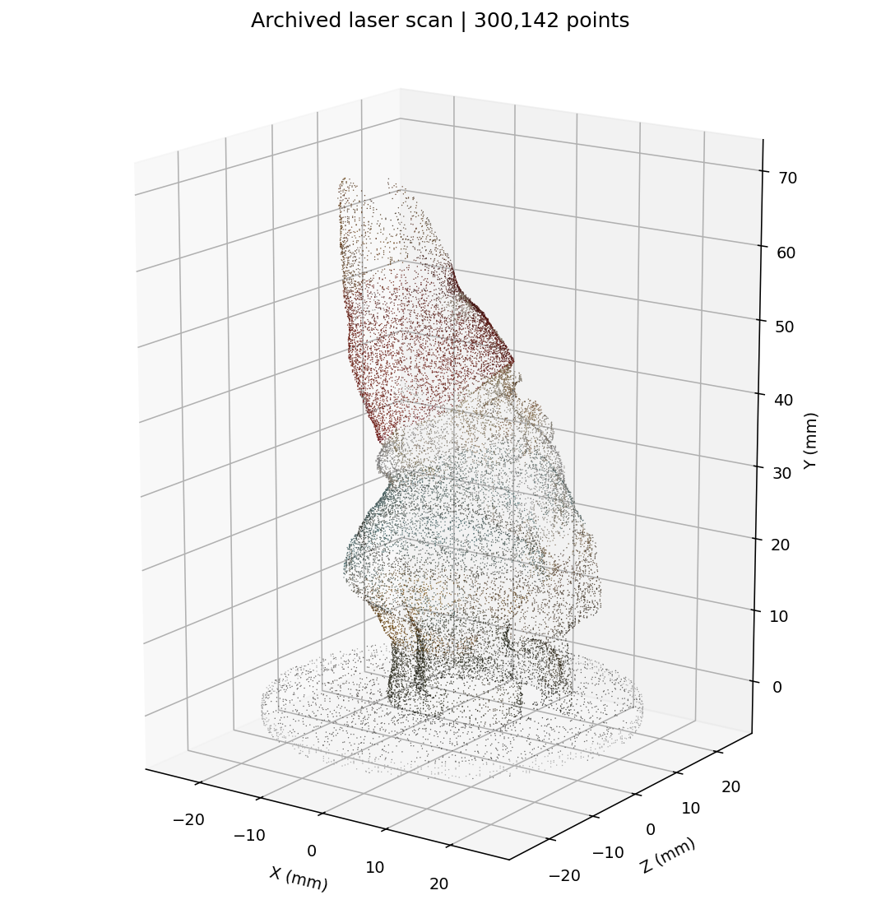
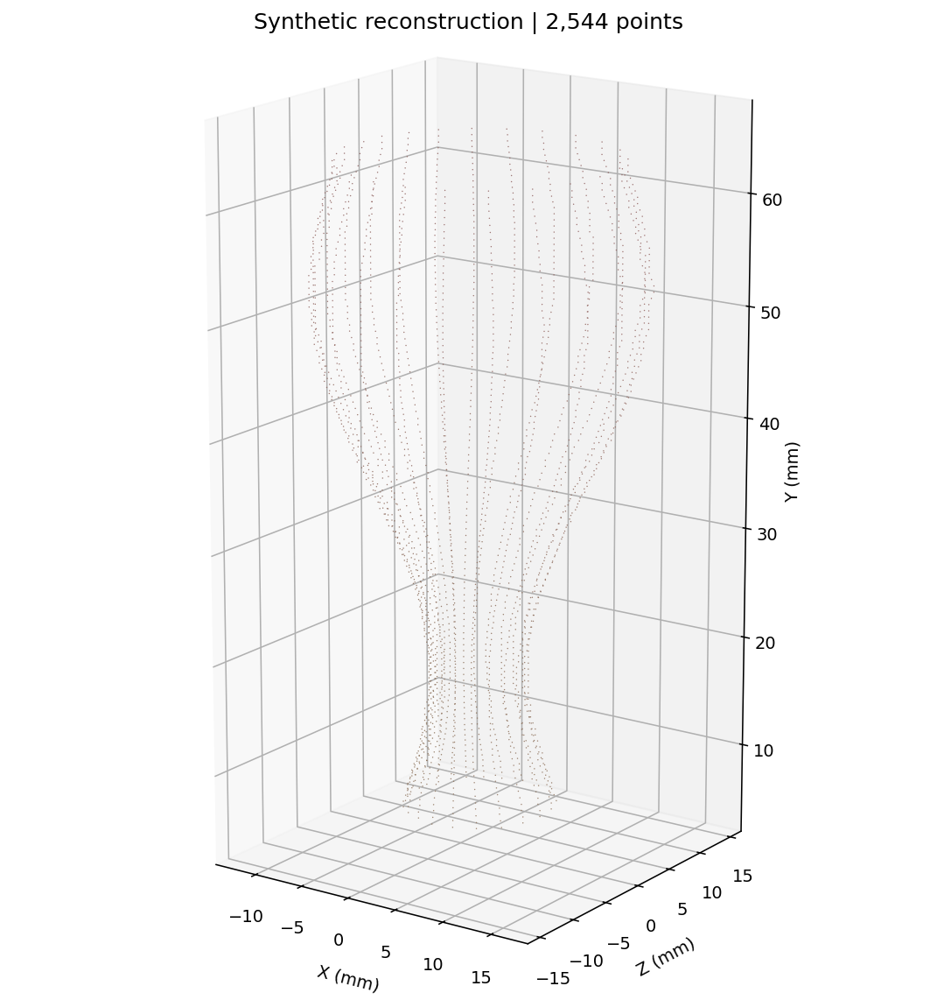

# Laser-Based 3D Reconstruction

**Python | OpenCV | NumPy | Camera Homography | Point Clouds | 3D Geometry**

A computer graphics final-exam project for reconstructing a colored 3D point cloud from **paired images of a rotating object**, captured with a green laser turned off and on. The project maps each detected laser-stripe pixel to millimeter coordinates using a four-point camera calibration, rotates the points according to turntable angle, and stores their positions and sampled colors as `X Y Z R G B` records.

This repository contains a cleaned, testable Python implementation of the original workflow, the original notebook and report, and the **archived 300,142-point scan**.



*Preview of the actual archived scan, sampled for rendering. The original report notes that point-cloud orientation may require correction in CloudCompare. RGB is brightened for visibility in this plot only.*

> **Source availability:** The original background and laser-on photographs were not included in the archived assignment. The saved point cloud is genuine archived output, but cannot be regenerated from the files in this repository. Tests and the executable example instead use clearly labeled artificial images; they do not validate geometric accuracy on physical scans.

## Processing stages

1. **Calibrate:** Use four or more pixel-to-world correspondences to estimate a planar homography.
2. **Detect the stripe:** Subtract each laser-off photo from its laser-on counterpart, threshold the difference, and apply a median filter.
3. **Reduce each row:** Find one representative laser column using Gaussian-weighted averaging.
4. **Map to physical units:** Transform `(column, row)` into `(X_plane_mm, Y_plane_mm)` with the homography.
5. **Rotate:** Form a 3D point `(X cos(theta), Y, X sin(theta))` using the turntable angle, one degree per frame in the original assignment.
6. **Preserve colors:** Sample RGB from the matching background photo and write an ASCII `.xyz` cloud.

This is laser-plane/turntable reconstruction under the geometry assumed by the academic assignment, not a calibrated general-purpose 3D scanner.

## Explore the original saved result

The file [`data/reference/original_scan.xyz`](data/reference/original_scan.xyz) includes **300,142 XYZRGB points**. Coordinates are in the nominal millimeter scale defined by the original calibration; orientation may need manual correction.

```bash
python -m pip install -r requirements-visualization.txt
python visualize.py --input data/reference/original_scan.xyz --output outputs/original_preview.png
```

The preview uses a reproducible point subsample and keeps original point positions unchanged. Each line in the `.xyz` file has `X Y Z R G B`, with integer RGB values from 0 to 255. You can also open this file in a compatible point-cloud tool such as CloudCompare.

## Run the self-contained demo

Python **3.10+** is recommended.

```bash
python -m venv .venv
# Windows: .venv\Scripts\activate
# Linux/macOS: source .venv/bin/activate
python -m pip install -r requirements-dev.txt

python scripts/generate_demo.py --output data/demo --frames 24
python reconstruct.py \
  --background-dir data/demo/colour \
  --laser-dir data/demo/laser \
  --calibration data/demo/calibration.json \
  --frames 24 --angle-step 15 --strict
python visualize.py --input outputs/reconstructed.xyz --output outputs/demo_preview.png
```

For PowerShell, enter the `python reconstruct.py` invocation on one line rather than using backslash continuations.

The demonstration produces artificial paired `.jpg` images, a calibration JSON file, an output `.xyz` file, and a small metadata summary. Its coordinates and scores are not results from the original laser-scanning experiment.



*Synthetic demonstration; no physical object was scanned.*

## Process your own photos

Organize equal-sized image pairs with matching filenames:

```text
my_scan/
├── colour/
│   ├── 0000.jpg
│   ├── 0001.jpg
│   └── ...
├── laser/
│   ├── 0000.jpg
│   ├── 0001.jpg
│   └── ...
└── calibration.json
```

Use `configs/original_calibration.json` to understand the expected JSON format, **not** as a calibration for a different camera. Its destination points correspond to measured physical coordinates in millimeters. Then run:

```bash
python reconstruct.py --background-dir my_scan/colour --laser-dir my_scan/laser \
  --calibration my_scan/calibration.json --frames 360 --angle-step 1 \
  --output outputs/my_scan.xyz --strict
```

The default algorithm matches the original grayscale background-difference method. Optional `--channel green` detects green-brightness increases instead. Adjust `--threshold`, `--median-kernel`, or `--sigma` for your imaging conditions. Unreadable pairs are skipped and reported unless you pass `--strict`.

## Notebook walkthrough

The [Jupyter notebook](notebooks/reconstruction_walkthrough.ipynb) inspects the original saved scan, generates artificial paired frames, and reconstructs a separate synthetic point cloud. It does not treat the synthetic outputs as physical scan results. Install `requirements-notebook.txt` and open the notebook in Jupyter or VS Code.

## Tests

```bash
python -m pip install -r requirements-dev.txt
python -m pytest -q
```

GitHub Actions runs unit tests and an end-to-end synthetic demo on every push and pull request. The tests cover image validation, laser extraction, homography, rotation, color ordering, saved cloud format, and missing-frame behavior. They do **not** reproduce the archived physical scan.

## Project layout

```text
laser-3d-reconstruction/
├── README.md
├── reconstruct.py                    # CLI: image pairs -> XYZRGB
├── visualize.py                      # Headless static point-cloud visualization
├── laser_reconstruction/
│   ├── core.py                       # Stripe detection, homography and rotation
│   ├── pipeline.py                   # Load calibration and process image pairs
│   ├── cloud.py                      # XYZRGB validation, I/O and statistics
│   └── synthetic.py                  # Fictional image-pair generator
├── scripts/generate_demo.py
├── notebooks/reconstruction_walkthrough.ipynb
├── configs/original_calibration.json # Archived experimental pixel references
├── data/reference/original_scan.xyz  # Archived 300,142-point scan
├── docs/
│   ├── original_report.pdf
│   ├── technical_notes.md
│   ├── original_point_cloud_preview.png
│   └── synthetic_point_cloud_preview.png
├── legacy/original_notebook.ipynb    # Original source, unchanged
├── tests/
├── .github/workflows/tests.yml
└── requirements*.txt
```

## Source and limitations

This is a maintained reimplementation of the archived assignment, not a byte-for-byte replay of its experiment. The report describes manual alignment work in CloudCompare. The original source photos, separate camera calibration image, and physical scan metadata are unavailable, so no accuracy, completeness or independent reproduction claim is made. See [technical notes](docs/technical_notes.md) for algorithm assumptions and the status of the original assets.
